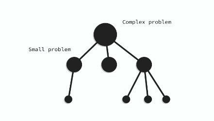

# 동적계획법 (Dynamic Programming, DP)

## 1. 개념

**동적계획법(Dynamic Programming, DP)** 은 큰 문제에 대한 답을 얻기 위해 **동일한 문제이지만 크기가 더 작은 문제들을 먼저 해결한 뒤, 그 결과들을 이용해 큰 문제를 비교적 간단하게 해결하는 알고리즘 설계 기법**이다.

<div align="center">
  
</div>

- 점화식(Recurrence Relation)을 기반으로 문제를 모델링한다.
- 반복문(`for` / `while`)을 이용하여 해결할 수도 있고, 재귀 함수를 이용하는 것도 가능하다.

---

## 2. DP의 핵심 조건

DP를 적용하기 위해서는 문제에 다음 두 가지 속성이 만족되어야 한다.

1. **중복 부분 문제 (Overlapping Subproblems)**
   - 큰 문제를 해결하는 과정에서 동일한 작은 문제들이 반복해서 나타난다.
2. **최적 부분 구조 (Optimal Substructure)**
   - 작은 부분 문제의 최적 해를 결합하여 큰 문제의 최적 해를 구할 수 있다.

---

## 3. 메모이제이션 (Memoization)

**메모이제이션(Memoization)** 은 복잡한 문제를 작은 문제로 쪼개어 해결할 때, **이미 계산한 결과를 저장해두고 다시 계산하지 않도록 하는 기법**이다.

- **하향식(Top-Down) DP**를 구현하는 핵심 방식이다.
- 한 번 구한 계산 결과를 딕셔너리(`dict`)나 리스트(`list`) 같은 메모리에 저장(캐싱)한다.
- 똑같은 입력(상태)이 들어오면 다시 계산하지 않고 저장된 값을 곧바로 반환한다.

---

## 4. 예제: 피보나치 수열 (Fibonacci)

피보나치 수열 점화식:
$$F(n) = F(n-1) + F(n-2) \quad (단, F(0)=0, F(1)=1)$$

### ① 일반 재귀 호출 (DP 적용 X)

동일한 부분 문제를 계속해서 반복 호출하여 지수적인 연산이 발생한다.

```python
def fibo(n):
    if n <= 1:
        return n
    return fibo(n - 1) + fibo(n - 2)
```

- **시간 복잡도**: $O(2^n)$ (동일한 부분 문제를 계속해서 중복 호출함)
  > $n$이 커질수록 호출 트리가 기하급수적으로 증가하여 심각한 성능 저하가 발생한다.

---

### ② 메모이제이션 적용 (Top-Down, 적용 O)

이미 계산한 값은 딕셔너리에 저장해 두고, 재호출 시 즉시 조회하여 반환한다.

```python
memo = {}

def fibo_memo(n):
    if n <= 1:
        return n

    # 이미 계산한 적이 있다면 미리 저장해둔 값을 반환
    if n in memo:
        return memo[n]

    # 계산한 적이 없다면 연산 후 메모리에 저장
    memo[n] = fibo_memo(n - 1) + fibo_memo(n - 2)
    return memo[n]
```

- **시간 복잡도**: $O(n)$
  > 각 상태($0 \sim n$)에 대해 최초 1회만 계산되고, 이후에는 $O(1)$의 딕셔너리 조회로 즉시 반환되므로 선형 시간에 해결된다.

---

### ③ 반복문 기반 DP (Bottom-Up, Tabulation)

작은 부분 문제부터 차례대로 DP 테이블을 채워나가는 상향식 방식이다.

```python
def fibo_bottom_up(n):
    if n <= 1:
        return n

    dp = [0] * (n + 1)
    dp[1] = 1

    for i in range(2, n + 1):
        dp[i] = dp[i - 1] + dp[i - 2]

    return dp[n]
```

- **시간 복잡도**: $O(n)$
- **공간 복잡도**: $O(n)$ (이전 두 값만 유지할 경우 $O(1)$로 최적화 가능)

---

## 5. Top-Down vs Bottom-Up 비교

| 구분 | 하향식 (Top-Down) | 상향식 (Bottom-Up) |
| :--- | :--- | :--- |
| **핵심 기법** | 메모이제이션 (Memoization) | 타뷸레이션 (Tabulation) |
| **구현 방식** | 재귀 함수 (Recursion) | 반복문 (`for`, `while`) |
| **진행 방향** | 큰 문제 $\to$ 작은 문제로 분할 호출 | 가장 작은 부분 문제부터 $\to$ 큰 문제로 누적 |
| **장점** | 점화식을 직관적으로 코드로 옮기기 쉬움 | 함수 호출 오버헤드가 없고 스택 오버플로우 위험 없음 |
| **단점** | 재귀 깊이 제한(Recursion Limit) 주의 필요 | 필요하지 않은 부분 문제까지 계산될 수 있음 |
