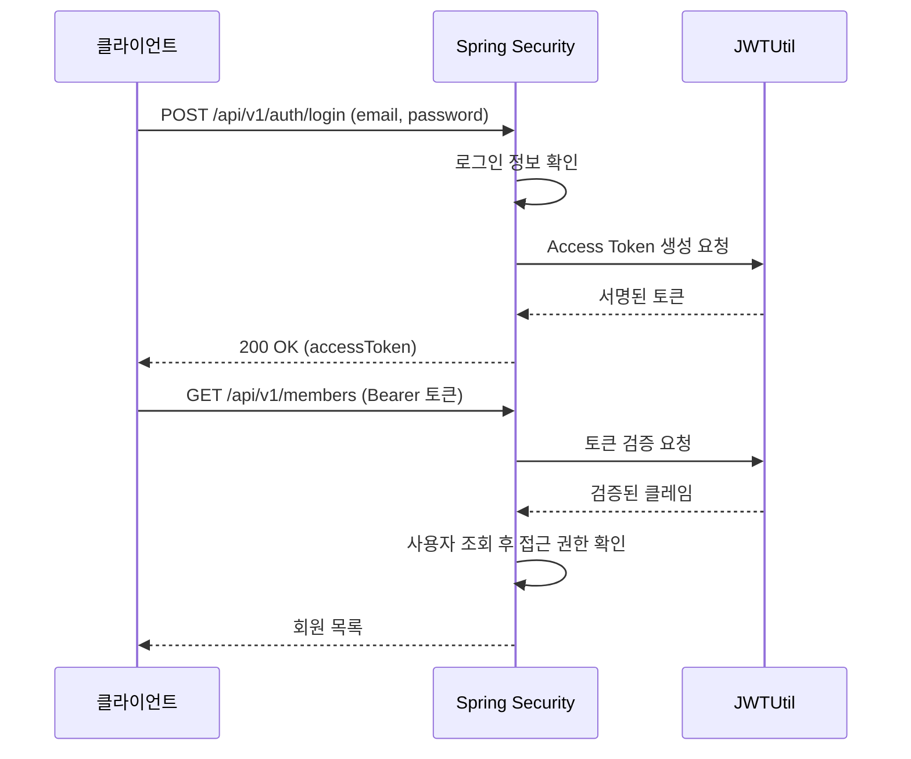

# JWT 인증과 Spring Security

로그인한 사용자가 회원 목록을 요청하면 서버는 어떻게 같은 사람인지 알 수 있을까? **세션 방식에서는 세션 ID로 서버의 로그인 정보를 찾고, JWT 방식에서는 클라이언트가 보낸 토큰을 검증한다.**

## 1. 세션과 JWT는 무엇이 다를까?

세션 ID는 **번호표**에 가깝다. 번호표만 보고는 누구인지 알 수 없어서 서버에 보관한 기록을 찾아야 한다. JWT(JSON Web Token)는 **신분증**에 가깝다. 사용자 정보를 토큰에 담고, 서버는 서명을 확인해 그 내용을 믿을 수 있는지 판단한다.

| 구분 | 세션 | JWT |
| --- | --- | --- |
| 로그인 성공 시 | 서버가 인증 상태를 저장하고 세션 ID를 쿠키로 전달한다. | 서버가 사용자 정보를 담은 토큰에 서명해 전달한다. |
| 다음 요청에서 | 브라우저가 세션 쿠키를 자동으로 보낸다. | 예제에서는 클라이언트가 요청 헤더에 토큰을 담아 보낸다. |
| 서버의 확인 방법 | 세션 ID로 메모리나 세션 저장소를 조회한다. | 토큰의 서명과 만료 시각을 확인한다. |
| 서버에서 로그아웃 처리 | 저장된 세션을 무효화할 수 있다. | 서명과 만료 시각만 검사하면 이미 발급한 토큰은 만료 전까지 유효하다. |

서버가 두 대라면 차이가 드러난다. 1번 서버에 로그인한 뒤 다음 요청이 2번 서버로 가면, 2번 서버에는 해당 세션이 없을 수 있다. Redis 같은 중앙 저장소로 세션을 공유할 수 있지만, 인증이 필요한 요청마다 조회가 발생하고 저장소 장애가 여러 서버의 인증에 영향을 준다.

JWT를 쓰면 각 서버가 토큰을 검증할 수 있어 로그인 세션을 공유할 필요가 없다. 이렇게 **요청 사이에 서버가 로그인 상태를 유지하지 않는 방식**을 무상태(Stateless)라고 한다.

## 2. JWT 안에는 무엇이 들어갈까?

JWT는 JSON 기반의 토큰 형식이다. 토큰을 헤더로 보낼지 쿠키로 보낼지, 어떻게 갱신할지는 구현할 때 정한다. 예제에서 사용하는 서명된 JWT는 세 부분을 점(`.`)으로 이어 붙인 문자열이다.

```text
Header.Payload.Signature
```

| 구성 | 담기는 내용 | 예시 |
| --- | --- | --- |
| Header | 토큰 유형과 서명 알고리즘 | `typ`, `alg` |
| Payload | 토큰이 전달하는 정보. 각 항목을 클레임(Claim)이라고 한다. | 이메일 `email`, 권한 `role`, 만료 시각 `exp` |
| Signature | 인코딩한 Header와 Payload를 점으로 연결한 값에 대한 서명 | HS256에서는 서버의 비밀 키로 계산한 서명값 |

**서명은 내용이 바뀌었는지 확인하는 데 쓰인다.** Header와 Payload는 Base64URL로 인코딩되어 있어 토큰을 가진 사람이라면 읽을 수 있다. 그래서 Payload에 비밀번호 같은 민감한 정보를 넣으면 안 된다.

## 3. JJWT로 토큰 발급하고 검증하기

Java 예제에서는 `jjwt-api`를 사용하고, 실행 시점에 `jjwt-impl`과 `jjwt-jackson`을 함께 사용한다. `JWTUtil`은 설정에서 읽은 문자열로 서명용 `SecretKey`를 만들고, 같은 발급 메서드에 다른 값을 넘겨 두 종류의 토큰을 만든다.

| 구분 | 용도 | subject | 직접 넣는 사용자 정보 | 예제 만료 시간 |
| --- | --- | --- | --- | --- |
| Access Token | 인증이 필요한 API 요청 | `accessToken` | `email`, `name`, `role` | 1분 |
| Refresh Token | Access Token 갱신 | `refreshToken` | `email` | 2분 |

발급할 때는 클레임과 만료 시각을 정한 뒤 키로 서명한다. `compact()`까지 호출하면 클라이언트에 전달할 토큰 문자열이 만들어진다.

```java
return Jwts.builder()
        .subject(subject)
        .claims(claims)
        .expiration(expireDate)
        .signWith(key)
        .compact();
```

요청에서 받은 토큰은 같은 키로 검증한 뒤 Payload를 꺼낸다.

```java
return Jwts.parser()
        .verifyWith(key)
        .build()
        .parseSignedClaims(jwt)
        .getPayload();
```

이때 만료 시각이 지났으면 `ExpiredJwtException`, 토큰 형식이 잘못됐으면 `MalformedJwtException`, 서명이 일치하지 않으면 `SignatureException`이 발생한다.

## 4. 로그인할 때와 API를 호출할 때



### 로그인 요청 · JWTAuthenticationFilter

`JWTAuthenticationFilter`는 `UsernamePasswordAuthenticationFilter`를 확장한다. 토큰 없이 로그인 요청이 들어오면 검증 필터를 그대로 지나고, 로그인 필터가 `email`과 `password`를 받아 `AuthenticationManager`에 인증을 맡긴다. 인증에 성공하면 `successfulAuthentication()`에서 **Access Token을 발급해 JSON으로 응답**한다.

### 회원 목록 요청 · JWTVerificationFilter

클라이언트는 로그인 응답에서 받은 토큰을 `Authorization` 헤더에 담는다. `Bearer`와 토큰 사이에는 공백 한 칸을 둔다.

```javascript
const response = await fetch("/api/v1/members", {
  headers: { Authorization: `Bearer ${accessToken}` },
});
```

1. `JWTVerificationFilter`가 헤더에서 `Bearer ` 접두어를 떼고 토큰을 꺼낸다.
2. `JWTUtil`로 토큰을 검증하고, 클레임의 `email`로 `UserDetailsService`에서 사용자를 조회한다.
3. 조회한 사용자와 **그 사용자의 권한**으로 `Authentication`을 만들어 현재 요청의 `SecurityContext`에 저장한다.
4. 다음 필터로 요청을 넘기면 Spring Security가 해당 API에 접근할 수 있는지 확인한다.

토큰이 없으면 검증 필터는 인증 정보를 채우지 않고 다음 필터로 넘긴다. 이때 로그인처럼 공개한 경로는 이용할 수 있고, 회원 목록처럼 인증이 필요한 경로는 접근이 제한된다.

## 5. 필터 순서가 중요한 이유

예제는 `SecurityFilterChain`을 두 개 둔다. Spring Security는 우선순위대로 확인해 **경로가 처음 일치하는 체인 하나**를 적용한다.

| 순서 | 요청 경로 | 인증 방식 |
| --- | --- | --- |
| `@Order(1)` | `/api/**` | JWT를 사용하고 세션 정책을 `STATELESS`로 설정 |
| `@Order(2)` | 나머지 웹 요청 | 폼 로그인과 세션 사용 |

API 체인에서는 커스텀 필터 세 개를 직접 생성해 다음 순서로 등록한다. Spring Boot는 필터를 빈으로 만들면 서블릿 필터 체인에도 자동으로 등록하므로, 여기서는 이중 등록을 피하기 위해 필터에 `@Component`를 붙이지 않는다.

1. **`SecurityExceptionHandlingFilter`**가 다음 필터를 호출하고, 거기서 발생한 예외를 JSON 응답으로 바꾼다.
2. **`JWTVerificationFilter`**가 요청에 담긴 토큰을 검증한다. `OncePerRequestFilter`를 확장해 한 요청에서 검증이 중복되지 않게 한다.
3. **`JWTAuthenticationFilter`**는 기본 로그인 필터 위치에서 로그인 요청을 처리한다.

예외 처리 필터가 맨 앞에 있어야 토큰 검증 실패와 로그인 실패를 한 곳에서 처리할 수 있다. 예제에서는 JWT 오류에 `401`과 `TOKEN_ERROR`를 반환하고, 이메일이나 비밀번호가 틀려도 `401`로 응답한다. 그 밖의 서버 내부 오류는 `500`으로 처리한다.
