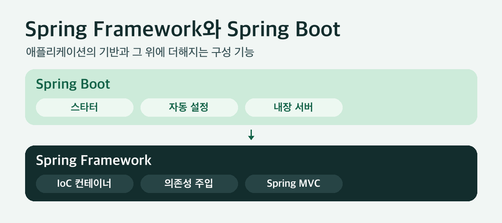
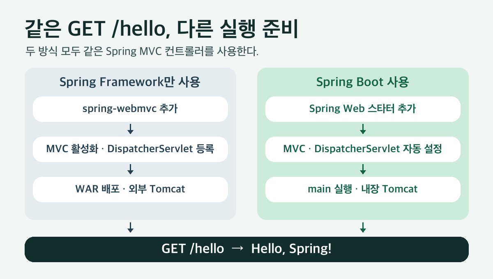

# Spring과 Spring Boot의 차이

**Spring Framework는 애플리케이션을 만드는 기반이고, Spring Boot는 그 기반 위에서 프로젝트를 구성하고 실행하는 데 필요한 기본값을 제공한다.** 이 글에서 Spring은 Spring Framework를 뜻한다.



## 무엇이 달라질까?

Spring은 객체를 생성하고 관리하는 IoC 컨테이너, 객체에 필요한 의존성을 연결하는 DI, 웹 요청을 처리하는 Spring MVC 등을 제공한다. 컨테이너가 관리하는 객체를 **빈(Bean)**이라고 한다. Spring만으로도 애너테이션으로 컴포넌트를 찾아 빈으로 등록하고, 생성자 주입으로 빈 사이의 의존성을 연결할 수 있다.

Spring Boot는 여기에 **스타터(Starter)**와 **자동 설정(Auto-configuration)**을 더한다. 스타터는 웹이나 데이터 접근 같은 목적에 맞는 의존성을 묶는다. 자동 설정은 클래스패스에 들어온 라이브러리, 설정값, 이미 등록된 빈 등을 확인해 조건에 맞는 구성을 적용한다. 예를 들어 직접 `DataSource` 빈을 등록하면 Boot는 기본 데이터 소스를 추가로 등록하지 않는다. 외부 DB에 연결할 때는 접속 주소와 인증 정보 같은 프로젝트별 설정이 필요하다.

| 비교 항목 | Spring Framework만 사용 | Spring Boot 사용 |
| --- | --- | --- |
| 의존성 | 필요한 Spring 모듈과 관련 라이브러리를 선택한다. | 기능별 스타터로 자주 함께 쓰는 의존성을 가져온다. |
| 웹 구성 | MVC 활성화와 `DispatcherServlet` 등록 등을 프로젝트에서 구성한다. | 서블릿 기반 웹 스타터를 추가하면 조건에 따라 MVC와 `DispatcherServlet`을 자동으로 구성한다. |
| 실행 | 예를 들어 WAR를 별도 Tomcat에 배포할 수 있다. | 내장 서버를 포함한 실행 가능한 JAR로 패키징해 `java -jar`로 시작할 수 있다. |
| 운영 상태 확인 | 프로젝트에 필요한 상태 확인 및 모니터링 기능을 구성한다. | Actuator 스타터를 추가하면 `/actuator/health` 같은 상태 확인 엔드포인트를 활용할 수 있다. |

## 예시 · 같은 `GET /hello` API 만들기

아래 컨트롤러는 두 방식에서 공통으로 사용하는 Spring MVC 코드다. 각 프로젝트에서 `example.hello` 패키지에 둔다.

```java
package example.hello;

import org.springframework.web.bind.annotation.GetMapping;
import org.springframework.web.bind.annotation.RestController;

@RestController
public class HelloController {

    @GetMapping("/hello")
    public String hello() {
        return "Hello, Spring!";
    }
}
```



### Spring Framework로 구성

`spring-webmvc`를 추가하고, Java 설정 클래스에 `@Configuration`, `@EnableWebMvc`, `@ComponentScan("example.hello")`를 붙인다. `AbstractAnnotationConfigDispatcherServletInitializer`를 사용해 이 설정 클래스를 연결하고 `DispatcherServlet`을 `/`에 매핑한다. 프로젝트를 WAR로 패키징해 외부 Tomcat에 루트 애플리케이션으로 배포하면 `/hello`로 요청할 수 있다.

### Spring Boot로 구성

Spring Initializr에서 **Spring Web**을 선택해 프로젝트를 만들고, 생성된 시작 클래스와 컨트롤러를 같은 패키지에 둔다. 이 구성에서는 Boot가 Spring MVC, `DispatcherServlet`, 내장 Tomcat을 자동으로 구성한다.

```java
package example.hello;

import org.springframework.boot.SpringApplication;
import org.springframework.boot.autoconfigure.SpringBootApplication;

@SpringBootApplication
public class HelloApplication {

    public static void main(String[] args) {
        SpringApplication.run(HelloApplication.class, args);
    }
}
```

두 예시 모두 기본 포트 8080에서 실행했다면 결과는 같다.

```console
$ curl http://localhost:8080/hello
Hello, Spring!
```

기존 서버나 배포 구조에 맞춰 구성 요소를 직접 선택해야 할 때는 Spring Framework만으로 구성할 수 있다. 새 애플리케이션을 빠르게 시작하려면 Spring Boot의 기본 구성을 활용하고, 프로젝트에 필요한 부분을 설정이나 빈으로 바꿀 수 있다.
